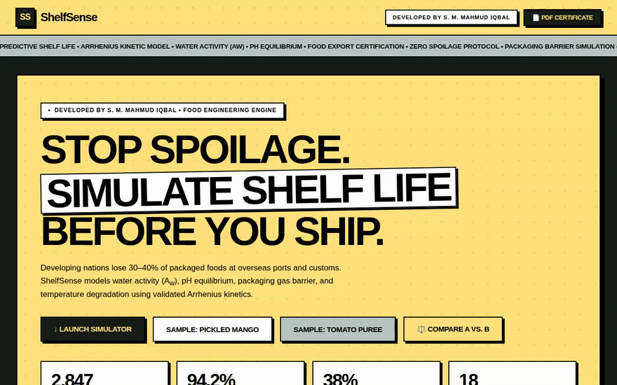

# ShelfSense — Predictive Shelf Life Engine for Food Exporters

> **Developed by S. M. Mahmud Iqbal**  
> *Food Engineering & Preservation Research | Neo-Brutalist Web Engine*

[](https://shelfsense-lemon.vercel.app)


[](https://github.com/SMMahmudIqbal/shelfsense)
[](LICENSE)

---

## Executive Summary

Developing nations lose **30% to 40% of packaged perishable foods** at overseas ports and customs due to unexpected spoilage, microbial proliferation, and barrier failure during maritime transit. Traditional shelf-life validation requires **6 to 12 months** of real-time stability testing or expensive commercial accelerated studies ($1,500 – $3,500 per SKU).

**ShelfSense** is an open food engineering web application that instantly simulates product degradation trajectories using validated **Arrhenius kinetics**, **water activity ($A_w$) thresholds**, **equilibrium pH limits**, and **packaging gas transmission rates**.

---

## Key Capabilities

### 1. Arrhenius Kinetic Shelf Stability Engine (v3)
- **Water Activity ($A_w$):** Models exponential microbial inhibition and moisture sorption stress across critical boundaries (0.50 – 0.99).
- **Acidification Thresholds:** Validates against the international acidified food cutoff (pH $\le$ 4.60) to prevent *Clostridium botulinum* spore germination — with a visible warning, and the risk label can never read "Low Risk" above pH 4.6.
- **Soluble Solids (°Brix):** Live model input (osmotic / water-binding screening factor).
- **Thermal Acceleration:** True Arrhenius shift using **activation energy $E_a$**; $Q_{10}$ is *derived* from $E_a$, not hard-coded. Spoilage-mode presets (typical literature midpoints, editable in Advanced): microbial 85, oxidation 65, moisture 35, colour/flavour 105, balanced 55 kJ/mol.
- **ASLT Anchor Mode:** If you have a measured shelf life, enter it with its test temperature — the engine then only temperature-shifts that anchor.
- **ASLT Planner:** Suggests accelerated test temperatures, durations and sampling points for confirming the predicted life.
- **Packaging Gas Barrier Matrix:** Typical published OTR / WVTR values per format feed an explicit barrier factor (verify against your supplier's film spec — closures and seals vary):

  | Packaging | OTR (cc/m²·day) | WVTR (g/m²·day) | Barrier |
  |---|---|---|---|
  | Glass Jar (hermetic lug) | 0.01 | 0.01 | Excellent |
  | Lacquered Tin Can | 0.01 | 0.01 | Excellent |
  | Multi-layer Retort Pouch (Alu-foil) | 0.1 | 0.1 | Excellent |
  | MAP Tray | 30 | 8 | Moderate |
  | PET Bottle (standard) | 75 | 18 | Low |

### 2. Formula A vs. Formula B Scenario Comparator
- Side-by-side formulation playground comparing baseline recipes against optimized reformulations.
- Dual-trajectory SVG decay curves plotted simultaneously.
- Dynamic **Days Gained** and percentage shelf-life extension callouts.

### 3. One-Click Export Screening Certificate (PDF Generator)
- Generates a screening certificate with a **deterministic** verification serial — the same inputs on the same day always produce the same serial (hash of inputs + date).
- The **Hazard Evaluation Table** (*Clostridium botulinum*, *Staphylococcus aureus*, lipid/Maillard kinetics) is **computed from the actual inputs** — a formulation at pH 5.5 / Aw 0.99 correctly FAILS, gets a "NOT EXPORT-CLEARED" watermark, and the certificate carries a screening-only disclaimer (not a lab ASLT result or a compliance guarantee).
- The ROI calculator's "Engineering Takeaway" is likewise generated from the actual numbers, including negative-ROI cases.
- Print-optimized (`@media print`) layout for sharing estimates with buyers and customs brokers.
- Digital sign-off block by **S. M. Mahmud Iqbal**.

### 4. Packaging Cost vs. Spoilage Savings Calculator (FCL Model)
- Full Container Load (20ft FCL) batch financial modeling.
- Quantifies packaging upgrade investment vs. cargo write-off risk elimination.
- Calculates **Protected Cargo Profit** and **Net Return on Investment (ROI %)**.

---

## Design System: Neo-Brutalism

ShelfSense is built with a high-contrast **Neo-Brutalist aesthetic**:

- **Palette:**
  - **Primary:** `#ffe17c` (Yellow) with a `32px x 32px` radial dot grid (10% opacity)
  - **Background:** `#171e19` (Charcoal)
  - **Accent:** `#b7c6c2` (Sage)
  - **UI Surfaces:** `#ffffff` (White)
  - **Text & Borders:** `#000000` (Pitch Black, `2px solid #000000`)
- **Typography:**
  - **Headings:** *Cabinet Grotesk* (Extrabold 800, tight tracking `-0.05em`)
  - **Body Text:** *Satoshi* (Medium 500 & Bold 700)
- **Hard Shadows:**
  - Standard elements: `box-shadow: 4px 4px 0px 0px #000000;`
  - Large containers: `box-shadow: 8px 8px 0px 0px #000000;`
- **Micro-Interactions:**
  - Buttons feature physical press physics: `transform: translate(4px, 4px); box-shadow: 0px 0px 0px 0px #000000;` on hover.

---

## Mathematical and Food Engineering Formulation

The core simulation couples the Arrhenius rate equation with moisture sorption kinetics:

$$k = A \cdot \exp\left(-\frac{E_a}{R \cdot T}\right)$$

Temperature enters through the exact Arrhenius ratio for the selected $E_a$ (with $Q_{10}$ derived as $Q_{10} = \exp\left[\frac{E_a}{R}\cdot\frac{10}{T(T+10)}\right]$):

$$\text{Shelf Life} = \text{BaseDays}_{\text{pkg}} \times f_{\text{barrier}} \times f(A_w) \times f(\text{pH}) \times f(°\text{Brix}) \times \exp\left[\frac{E_a}{R}\left(\frac{1}{T} - \frac{1}{298.15}\right)\right] \times \text{Buffer}_{\text{market}}$$

Where $f_{\text{barrier}}$ comes from the pack's OTR/WVTR relative to standard PET, weighted by the selected spoilage mode, and $f(°\text{Brix})$ is a clamped osmotic screening factor, $1 + (°\text{Brix} - 30) \times 0.003$ within $[0.90, 1.18]$.

Where:
- $f(A_w) = 0.25 + 0.75 \cdot \left[1 - \left(\frac{A_w - 0.50}{0.50}\right)^{1.85}\right]$
- $f(\text{pH}) = 1.25 - (\text{pH} - 2.0) \cdot 0.05$ (for $\text{pH} < 4.60$)
- $f(\text{pH}) = 1.00 - (\text{pH} - 4.60) \cdot 0.16$ (for $\text{pH} \ge 4.60$)

---

## Getting Started

### Local Setup
No build tools or heavy dependencies required. Just clone and open in any modern browser:

```bash
git clone https://github.com/SMMahmudIqbal/shelfsense.git
cd shelfsense
# Open index.html directly
start index.html # On Windows
```

### Live Deployment
Deploy with zero configuration to Vercel:

```bash
npm install -g vercel
vercel --prod
```

---

## Author and Attribution

**Developed by S. M. Mahmud Iqbal**  
- GitHub: [@SMMahmudIqbal](https://github.com/SMMahmudIqbal)  
- Focus: Food Process Engineering, Preservation Science & Applied AI Systems  

---

## License

This project is licensed under the MIT License — see the [LICENSE](LICENSE) file for details.

---

## Changelog

### v3.0.0 — 15 Oct 2026
- Certificate hazards are now evaluated from the actual inputs (previously hard-coded PASS); deterministic serial; "NOT EXPORT-CLEARED" watermark on failures; screening-only disclaimer and honest stamp wording.
- °Brix is a live model input (it previously changed nothing).
- pH > 4.6 warning + risk-label cap; dynamic ROI takeaway (including negative ROI).
- Ea-based Arrhenius with spoilage-mode presets and derived Q10; real OTR/WVTR packaging data with an explicit barrier factor; per-market screening notes.
- ASLT planner (collapsed, optional) and ASLT anchor mode for measured shelf life.
- Honest hero stats (the previous "2,847 batches / 94.2% lab correlation" figures had no source and were removed).
- Meta description, Open Graph card (`og-image.png`) and favicon; visible keyboard focus; Escape/backdrop closes the certificate modal.
- UX kept deliberately simple: the default form gained exactly one plain-language field ("What spoils first?"); everything advanced lives behind one collapsed panel.

### v2.4.1 and earlier
- Original single-file estimator: fixed Q10 = 2.0, packaging base-days lookup, static certificate table.
